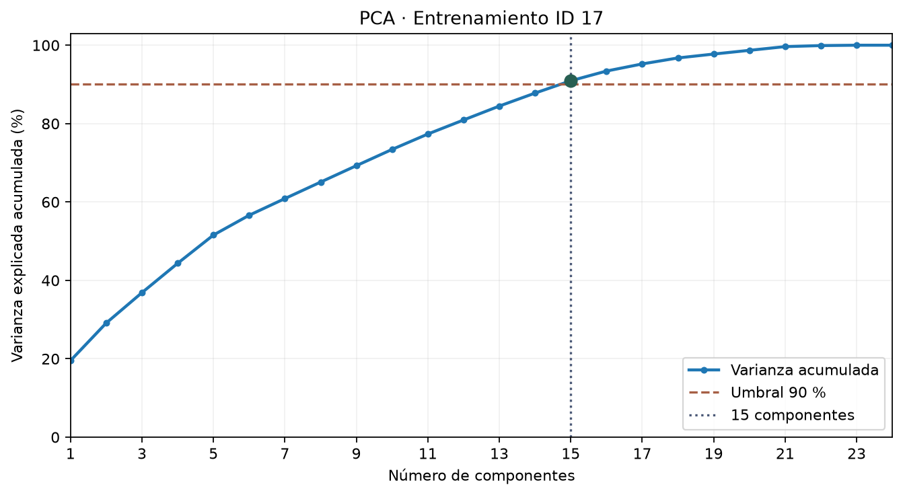
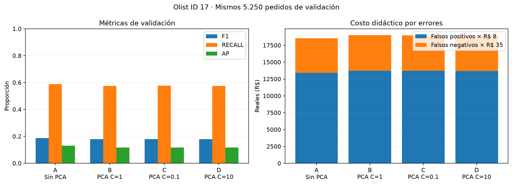
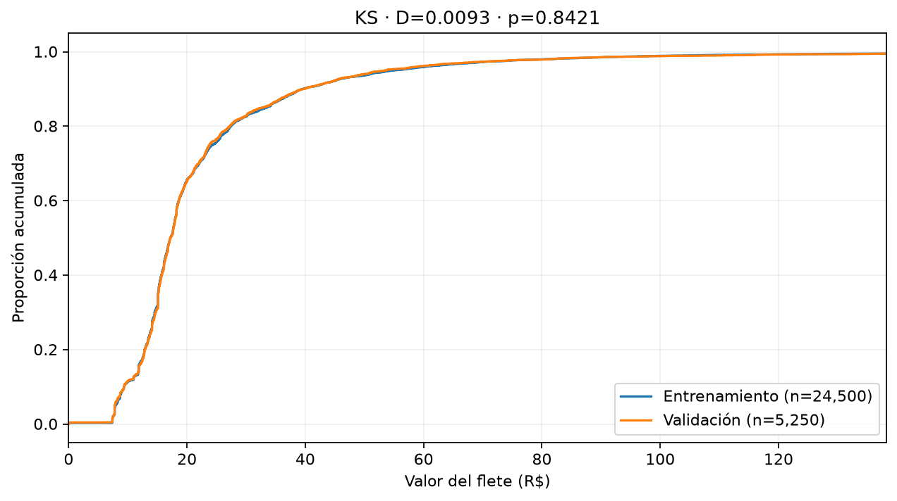

# Data Analytics ML Challenge · Olist

**Predicción de entregas tardías | Tercer corte, 2026-2**

**Estudiante:** Sara Valentina Guauque Zarrate  
**Universidad:** Universidad Central · Ingeniería de Sistemas y Computación  
**Profesor:** Elias Buitrago Bolivar  
**ID individual:** `17` · **Semilla:** `1017`  
**Estado:** Laboratorios S12 y S14 ejecutados, con métricas verificadas y evidencias versionadas.

## Problema de negocio

Busco anticipar si un pedido de comercio electrónico se entregará después de la fecha prometida, utilizando el conjunto público **Brazilian E-Commerce Public Dataset by Olist**. Integro las tablas de pedidos, ítems, productos, clientes, vendedores, pagos y categorías para que **cada fila represente un pedido**. La variable objetivo es `is_late` (1 = entrega tardía, 0 = puntual).

El proyecto usa **28 predictores** conocidos al confirmar la compra: 24 numéricos y 4 categóricos. No emplea la fecha real de entrega como predictor para evitar fuga de información.

### Individualización y reproducibilidad

| Elemento | Valor |
|---|---:|
| ID del estudiante | **17** |
| Semilla de muestreo | **1017** |
| Huella de pedidos S12 y S14 | **`55ced66ce4f4`** |
| Tamaño de muestra | **35.000** |
| Entrenamiento | **24.500** |
| Validación | **5.250** |
| Prueba final reservada | **5.250** |

Los dos laboratorios descargan los **mismos siete CSV** desde una revisión fija de Olist. Los datos completos no se publican en este repositorio. El conjunto de prueba no ha intervenido en la selección de modelos; se conserva para el cierre del desafío.

---

## Laboratorio 1 · Semana 12

**Notebook:** [S12_ML_Challenge.ipynb](notebooks/S12_ML_Challenge.ipynb)  
**Resultados:** [S12_resultados_ID_17.json](reports/S12_resultados_ID_17.json)  
**Análisis:** [S12_analisis_ID_17.md](reports/S12_analisis_ID_17.md)

Construí una referencia de clase mayoritaria y regresiones logísticas con y sin ponderación `class_weight='balanced'`. El modelo balanceado alcanzó **58,59 % de Recall, 18,55 % de F1 y 65,22 % de Accuracy** sobre validación. Detectó 208 de los 355 retrasos, pero generó 1.679 falsas alarmas. El costo hipotético fue **R$ 18.577**, por encima de la referencia sin alertas (**R$ 12.425**).

También se incluye una regresión Ridge que predice días hasta la entrega, con MAE de **5,22 días** en validación.

---

## Laboratorio 2 · Semana 14: PCA, regularización y KS

La clase de la semana 13 no se realizó y su contenido de reducción de dimensionalidad se incorporó a la semana 14, según las instrucciones del profesor. Utilicé la **misma muestra del ID 17** y comparé cuatro configuraciones con `class_weight='balanced'`, umbral 0,50 y las mismas particiones.

**Notebook:** [S14_Lab2_PCA_Validacion_ID_17.ipynb](notebooks/S14_Lab2_PCA_Validacion_ID_17.ipynb)  
**Resultados JSON:** [S14_resultados_ID_17.json](reports/S14_resultados_ID_17.json)  
**Comparación CSV:** [S14_experimentos_ID_17.csv](reports/S14_experimentos_ID_17.csv)  
**Interpretación:** [S14_analisis_ID_17.md](reports/S14_analisis_ID_17.md)  
**Guía de ejecución:** [S14_metodologia_y_entrega.md](docs/S14_metodologia_y_entrega.md)

### 1. PCA: compresión con 90 % de varianza

Partí de **24 variables numéricas**. Con imputación, estandarización y PCA ajustados solo sobre entrenamiento, se conservaron **15 componentes que explican el 90,93 % de la varianza**. Las cuatro variables categóricas mantuvieron su tratamiento separado con One-Hot Encoding.



### 2. Comparación de modelos

| Configuración | Recall | F1 | AP | Falsos positivos | Falsos negativos | Costo estimado |
|---|---:|---:|---:|---:|---:|---:|
| **A · sin PCA, C=1** | **58,87 %** | **18,64 %** | **13,09 %** | 1.678 | 146 | **R$ 18.534** |
| B · PCA 90 %, C=1 | 57,46 % | 17,94 % | 11,78 % | 1.715 | 151 | R$ 19.005 |
| C · PCA 90 %, C=0,1 | 57,75 % | 18,01 % | 11,74 % | 1.716 | 150 | R$ 18.978 |
| D · PCA 90 %, C=10 | 57,46 % | 17,97 % | 11,74 % | 1.711 | 151 | R$ 18.973 |

**Resultado:** la alternativa A, sin PCA, tuvo el **F1 más alto y el menor costo** entre las cuatro. PCA permitió resumir información, pero no mejoró las predicciones en esta comparación. Los cambios de regularización tampoco superaron a A. Se conserva el modelo A como referencia para seguir investigando cómo reducir falsas alarmas.

El costo se calculó con los **supuestos académicos R$ 8 por falso positivo y R$ 35 por falso negativo**; no representa un costo real declarado por Olist.



### 3. Kolmogorov–Smirnov sobre valor_flete

Se comparó la distribución del flete en entrenamiento (n=24.500) y validación (n=5.250):

- **H0:** el flete sigue la misma distribución poblacional en ambas particiones.
- **H1:** las distribuciones difieren.
- **D = 0,00933**; **p = 0,84207**; **α = 0,05**.

**Decisión:** no rechazar H0. No encontré evidencia suficiente de una diferencia entre las distribuciones del flete; **no equivale a demostrar que sean idénticas**, ni compara la calidad de los clasificadores. Los valores monetarios repetidos limitan la interpretación de la prueba clásica.



---

## Organización del repositorio

```text
lab1-entregas-tardias/
├── .github/workflows/
│   ├── tests.yml
│   ├── ejecutar_olist_id17.yml
│   └── ejecutar_olist_s14_id17.yml
├── data/                   # Carpetas locales; sin CSV originales
├── docs/
│   ├── Guia_Olist_S12.html
│   └── S14_metodologia_y_entrega.md
├── notebooks/
│   ├── S12_ML_Challenge.ipynb
│   └── S14_Lab2_PCA_Validacion_ID_17.ipynb
├── reports/
│   ├── S12_*.json / .csv / .md
│   ├── S14_*.json / .csv / .md
│   └── figuras/            # Gráficas de S12 y S14
├── scripts/
│   ├── ejecutar_lab.py
│   ├── ejecutar_s14.py
│   ├── verificar_entrega.py
│   └── verificar_s14.py
├── src/
├── tests/
├── requirements.txt
└── README.md
```

## Cómo reproducirlo

**GitHub Actions:** abre la pestaña **Actions**, selecciona **S14 - PCA y validación - ID 17** y ejecuta **Run workflow** sobre la rama `main`. La ejecución descarga Olist, corre todas las celdas, verifica los resultados, guarda un artefacto y registra las evidencias en `reports/`.

**Google Colab:** [abrir el notebook S14](https://colab.research.google.com/github/SaraGuauque/lab1-entregas-tardias/blob/main/notebooks/S14_Lab2_PCA_Validacion_ID_17.ipynb) y usar **Entorno de ejecución → Ejecutar todas**. Para conservar las evidencias en GitHub deben versionarse los archivos generados.

**Localmente (Python 3.11):**

```bash
python -m pip install -r requirements.txt
python -m pytest -q
python scripts/ejecutar_s14.py
python scripts/verificar_s14.py
```

> Nota: las interpretaciones de negocio ya están escritas en el notebook y en el informe S14. Al repetir la ejecución desde este repositorio se conservan esas respuestas, y las métricas se regeneran a partir de los mismos datos.

## Estado de las entregas

- [x] Laboratorio S12: notebook ejecutado, respuestas, métricas y JSON reales.
- [x] Laboratorio S14: PCA, 4 configuraciones, costos, KS y análisis interpretativo.
- [x] Autoverificación y pruebas automáticas para ambos laboratorios.
- [x] Gráficas, CSV y JSON en `reports/`, sin datos originales.
- [x] Historial de commits con los experimentos y las correcciones.
- [ ] S15 y S16: continuar cuando el profesor comparta los siguientes requerimientos.

## Fuentes

- Olist (2018). *Brazilian E-Commerce Public Dataset by Olist*, Kaggle, licencia CC BY-NC-SA 4.0.
- Revisión fija de los CSV: `spdrio/Brazilian-E-Commerce-Public-Dataset-by-Olist`, commit `fa0cc6d1aff713d3c8b9a1e633b56889881848bf`.
- Materiales del profesor: *Guia Olist S12*, *Semana14_Olist* y *Lectura_Apoyo_S14*, Elias Buitrago Bolivar, Universidad Central, 2026-2.
